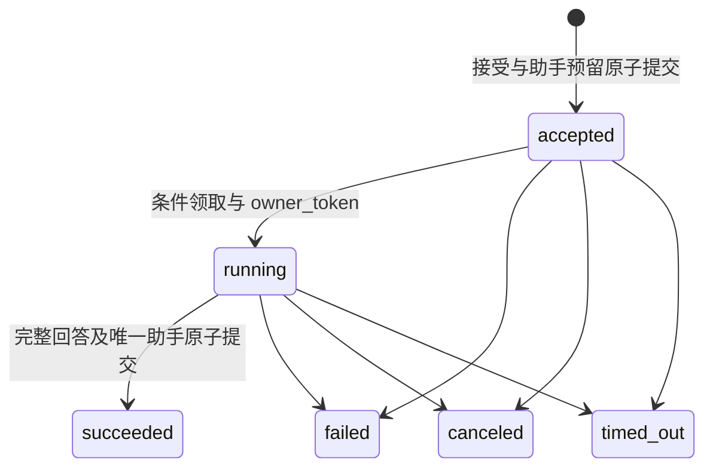

# 有引用对话 Agent 开发约束

本文对应 `add-cited-conversational-agent` 的后端实现。领域、应用、PostgreSQL 生命周期、Eino 编排、统一可见性投影与 HTTP/SSE 已接入；数据与配额见[操作说明](agent-run-data.md)，接入见[接口说明](agent-runs.md)，恢复见[执行运维](agent-run-operations.md)。Web 页面尚未实现。

## 状态与执行权



四个终态不再迁移。创建时固定总 deadline，默认 60 秒，包含排队；续租不延长期限。执行权由 running、owner_token、未到期租约和 deadline 共同确定，租约固定 10 秒。`Complete` 要求有效执行权；应用仍必须在写事务中复核当前授权、引用和消息配额。取消与成功依赖数据库条件写入，先提交者生效。

同一用户消息最多接受三个回合且最多一个成功回合。首次不得指定 `retry_of`；之后只能指向最新 failed/canceled/timed_out 回合，当前文章和精确约束保持原值。接受幂等只重放最初 accepted 快照，不表示重新生成。失败 partial 不作为助手消息或成功历史。

每账户最多两个活动回合，每会话最多一个。接受在账户锁内预留一个助手名额，不增加 `message_count` 或序号；成功兑换，其他终态释放。最终保存按当前配额复核。只剩一个消息名额时可以保存 user，但随后没有助手名额，无法接受生成。

## 事务及端口

锁顺序固定为：账户状态 → 接受幂等 → 会话 → 回合 → 事件。普通执行跳过幂等锁。候选扫描先无锁取得 ID，再按同一顺序领取；禁止先锁回合后等待账户。模型及工具网络请求在事务外运行。片段、来源和对应事件短事务提交后才能投递，完整回答、助手消息、预留消费及终态事件同次提交。

端口定义见 `backend/internal/application/agentrun/ports.go`：

| 端口 | 职责与失败边界 |
| --- | --- |
| Repository / Store / TxManager | 所有权、接受事实、预留、执行权、短事务提交、保留期维护；SQL 与驱动留在 Infrastructure |
| CurrentAuthorization | 原账户与登录会话当前有效性，包含账户禁用和登录撤销；不依赖访问令牌自然到期 |
| ExecutionReader / Guard | 同一短读取快照先授权后检查执行权；每次调用前检查，写入仍须事务内复核 |
| EvidenceFacts | 在当前数据库快照批量读取公开性、修订与精确约束；失败关闭读取，不能用索引或缓存代替 |
| ContextSource / PreferenceSource | 本人最近最多六个完整成功回合与独立偏好来源；当前 EmptyPreferences 返回空 |
| ToolInvoker | 服务端白名单、可信身份、严格参数、逐次权限和整批预算；不会动态加载模型提出的工具 |
| Runner / OutputSink | 编排执行与完整候选片段提交分开；Runner 不拥有成功助手写入权，框架事件不外泄 |
| EventReader / VisibilityProjector | 有界读取持久事件；历史、详情、上下文及重放统一复核并投影失效引用 |
| Observer | 固定状态、错误分类、调用数、用量完整性与耗时；结构不包含身份、文章 ID 或私密正文 |

`Guard` 的读取授权故障与登录失效分别分类；数据库故障不能伪装成登录撤销。所有 Provider 原始异常必须映射到固定安全分类。Domain/Application 不引入 Eino、Hertz、SQL、HTTP 或指标 SDK，现有 architecture 测试持续检查此约束。

## 预算与证据

默认四次模型调用包含独立成文，取证最多三次，工具尝试最多六次。整批工具先预留再执行，非法参数与失败尝试也计数。每次模型为实际序列化输入字节加协议开销及最大输出预留；完整 usage 结算实际值，否则保留预留并返回 null 用量，`usage_complete=false`。超额 Provider 报告阻止后续动作，不能回滚已发生费用。

证据 `version=1`、`kind=article`，记录本轮身份、文章修订、取得时间、摘要/正文和截断。仅实际保留且提供给成文模型的材料能建立证据。逐字引文必须出现在所引用材料中；正文细节策略要求正文证据。合法来源身份和逐字匹配仍不能证明自由文本语义正确。

回答为 `version,kind,blocks,references,cards,redacted`，kind 为 answer/no_results/clarification。正常回答最多 32 块、10 个来源，默认 8000 Unicode code point；同文章修订复用首次出现编号。卡片来自可信工具和当前事实，模型只提供文本及 evidence_id。组装器任何片段拒绝都会阻止后续完成，已接收块保留为 partial。服务端模板及有界 NDJSON 解码已实现，所有完整片段先校验和提交，再投递。

## 五份规格的落点

| delta spec | 实现位置 |
| --- | --- |
| agent-runs | 六态、deadline、执行权、重试和配额；PostgreSQL 接受/取消/提交及 supervisor |
| agent-conversations | 受控助手写入、活动追加冲突与预留；旧会话服务和不可变历史投影 |
| agent-evidence | 本轮证据、逐块引用、编号及 partial；流式解码、事实复核和统一投影 |
| agent-orchestration | 预算、可信调用及技术独立端口；Eino ADK 取证、独立成文和有限上下文 |
| agent-streaming | 五类业务事件、独立读取及投影端口；持久化序号、Bearer SSE、背压和 nginx 验证 |

SSE 断线只结束订阅，显式 cancel 才停止回合。持久事件只允许 run.status、tool.status、answer.sources、answer.block、run.terminal；stream.error 属于无位置的订阅控制事件，不持久化。SSE、详情、助手历史和上下文不得存在返回未经复核正文的旁路。

## 扩展边界

当前工具只允许站内 search_articles、recommend_articles、get_article。笔记写入、外部搜索、写作产物、长期偏好均未支持；推荐画像仍只通过推荐工具使用，不能声称已记住新偏好。未来扩展需独立变更定义来源类型、工具权限、副作用、版本、网络边界和写入授权，不能通过通用引用或工具注册自动授予能力。固定确定性阅读评测子集见[测试说明](agent-testing.md)；Web 对话页面和完整产品评测由下一 change 承接。

本阶段验证：

```bash
cd backend
GOCACHE=/tmp/feedvelis-go-cache go test -race ./internal/domain/agentrun ./internal/domain/agentevidence ./internal/application/agentrun ./internal/architecture
```
